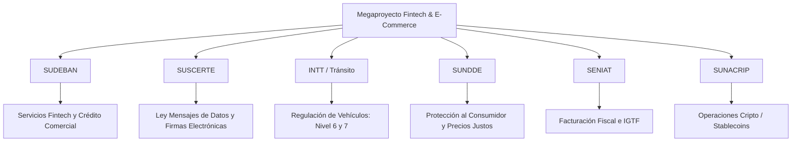

# MARCO REGULATORIO, LEGAL Y DE CUMPLIMIENTO — REPÚBLICA BOLIVARIANA DE VENEZUELA

**Proyecto:** Megaproyecto Fintech & E-Commerce  
**Documento:** Análisis de Normativa, Cumplimiento y Requisitos de Producción  
**Versión:** 1.0.0 (Etapa 11 y 15)  
**Fecha:** 2026-10-14  
**Clasificación:** DOCUMENTO TÉCNICO Y REGULATORIO — PENDIENTE DE REVISIÓN LEGAL EXTERNA

---

## 1. ADVERTENCIA PRELIMINAR Y ALCANCE

> [!IMPORTANT]
> El cumplimiento de pruebas técnicas, criptográficas y de arquitectura de software **no sustituye la asesoría ni la autorización jurídica formal**. Este documento identifica con rigor las leyes, resoluciones y entes reguladores vigentes en Venezuela aplicables a la plataforma, distinguiendo expresamente qué requisitos están resueltos en código y cuáles constituyen **bloqueos regulatorios y de negocio** antes de transaccionar con dinero real.

---

## 2. ENTES REGULADORES Y MARCO LEGAL APLICABLE

### 2.1. SUDEBAN (Superintendencia de las Instituciones del Sector Bancario)
* **Normativa:** Ley de Instituciones del Sector Bancario y Resolución N° 001.21 ("Normas que Regulan los Servicios de Tecnología Financiera - Fintech").
* **Aplicación:**
  - **Intermediación Financiera:** El otorgamiento de créditos comerciales mediante fondos propios de los comercios afiliados (BNPL / Compra Ahora, Paga Después) no constituye captación de fondos del público, pero sí califica como *Servicio Conexo de Pago y Financiamiento Tecnológico*.
  - **Requisito para Producción:** Obtener la certificación de *Institución Emisora de Tecnología Financiera (ITF)* o asociarse mediante alianza estratégica con una institución bancaria nacional supervisada.
  - **Prohibición Expresa:** La plataforma **no puede captar depósitos del público** ni prometer rendimientos financieros sin licencia bancaria plena.

### 2.2. SUSCERTE y Ley de Mensajes de Datos y Firmas Electrónicas (Gaceta Oficial N° 37.076)
* **Distinción Jurídica Vital:**
  - **Firma Electrónica Simple vs. Certificada:** El sistema actual genera un **Contrato Digital con huella criptográfica SHA-256** inmutable. Técnicamente garantiza la no alteración del documento (*integridad*).
  - Sin embargo, conforme al Artículo 16 de la Ley, para que el contrato tenga **plena fuerza ejecutiva equiparable a una firma autógrafa notariada**, debe emitirse a través de un Proveedor de Servicios de Certificación acreditado ante la **Superintendencia de Servicios de Certificación Electrónica (SUSCERTE)**.
  - **Estado:** En modo demostración/desarrollo, el contrato se marca explícitamente como *Documento Demostrativo sin efectos ejecutivos reales*. Para producción, se debe integrar un proveedor de firma acreditado (ej. PROCERT u homólogo homologado).

### 2.3. INTT (Instituto Nacional de Transporte Terrestre) — Niveles 6 (Motos) y 7 (Autos)
* **Distinción Legal Esencial (Exigencia del Prompt Maestro):**
  - **Habilitación para Conducir vs. Capacidad para Financiar y Adquirir:**
    * Poseer licencia de conducir (2do grado para motocicletas, 3er grado para automóviles) y Certificado Médico Vial únicamente acredita **aptitud física y técnica para circular por vías públicas**.
    * **NO confiere solvencia patrimonial, capacidad de pago, ni aprobación crediticia automática.** El sistema de riesgo de la plataforma evalúa la solvencia (DTI, historial, estabilidad de ingresos) de forma totalmente independiente a la licencia.
  - **Requisitos Legales para Financiamiento y Entrega de Vehículos en Venezuela:**
    1. **Reserva de Dominio:** Conforme al Artículo 1.815 del Código Civil Venezolano, la venta a plazos de vehículos automotores debe instrumentarse mediante documento autenticado ante Notaría Pública con cláusula de Reserva de Dominio a favor del acreedor hasta la cancelación de la última cuota (máx 24 cuotas en motocicletas, máx 48 en autos).
    2. **Título y Registro:** El Certificado de Registro de Vehículo expedido por el INTT debe reflejar el gravamen de reserva de dominio.
    3. **Póliza de Seguro:** Póliza de Responsabilidad Civil de Vehículos (RCV) obligatoria por ley y póliza de cobertura amplia o pérdida total durante la vigencia del financiamiento.
    4. **Revisión Técnica / Experticia Vehicular:** Verificación serial (chasis y motor) por el INTT o el Cuerpo de Investigaciones Científicas, Penales y Criminalísticas (CICPC).

### 2.4. SUNDDE (Superintendencia Nacional para la Defensa de los Derechos Socioeconómicos)
* **Normativa:** Ley Orgánica de Precios Justos y Ley de Protección al Consumidor.
* **Obligaciones:**
  - Transparencia absoluta en la fijación de precios: Debe publicarse el precio de contado y el precio total financiado, sin cargos ocultos.
  - Prohibición de usura en tasas de financiamiento moratorio o administrativo.
  - Políticas de garantía, cambio y devolución claramente expuestas por los comercios afiliados.

### 2.5. SENIAT (Servicio Nacional Integrado de Administración Aduanera y Tributaria)
* **Normativa:** Ley de Impuesto al Valor Agregado (IVA) y Ley de Impuesto a las Grandes Transacciones Financieras (IGTF).
* **Obligaciones:**
  - Emisión de factura legal o máquina fiscal autorizada por parte del comercio emisor al momento de perfeccionarse la compraventa.
  - Percepción del IGTF (alícuota del 3%) en operaciones canceladas en divisas o criptoactivos cuando corresponda legalmente.

---

## 3. CHECKLIST TÉCNICO DE CUMPLIMIENTO IMPLEMENTADO

| Área Técnica | Estado en Código | Evidencia en Repositorio |
| :--- | :--- | :--- |
| **Aislamiento Multi-Tenant** | COMPLETADO Y VERIFICADO | Clientes y comercios solo acceden a sus propios registros (`HTTP 403`). Pruebas en `auth.test.ts`, `payments.test.ts`, `commerce.test.ts`. |
| **Inmutabilidad Contractual** | COMPLETADO Y VERIFICADO | Hashing SHA-256 del contenido contractual y verificación pública en `/api/v1/contracts/:id/verify`. |
| **Persistencia Transaccional** | COMPLETADO Y VERIFICADO | Motor de almacenamiento persistente (`fintech_db.json`), migraciones SQL 001-005 listas para PostgreSQL. |
| **Trazabilidad y Auditoría** | COMPLETADO Y VERIFICADO | Historial de estados de crédito, pagos y órdenes con timestamp, actor y motivo. |
| **Separación de Roles (RBAC)** | COMPLETADO Y VERIFICADO | Roles `CLIENT`, `MERCHANT_OWNER`, `MERCHANT_STAFF`, `RISK_ANALYST`, `ADMIN` con privilegio mínimo. |
| **Prevención de Ataques** | COMPLETADO Y VERIFICADO | Sanitización de contraseñas con PBKDF2/SHA-512, salteado criptográfico, cookies HttpOnly SameSite, rate limiting, anti-mass assignment. |

---

## 4. MATRIZ DE REQUISITOS PENDIENTES ANTES DE OPERAR CON DINERO REAL

| Requisito | Tipo de Bloqueo | Dependencia Externa | Acción Requerida |
| :--- | :--- | :--- | :--- |
| **Licencia de Operador Fintech** | Regulatorio | SUDEBAN | Tramitar solicitud formal ante SUDEBAN según Resolución N° 001.21. |
| **Firma Digital Certificada** | Legal / Jurídico | SUSCERTE / Proveedor Homologado | Integrar API de firma electrónica calificada para contratos vinculantes con reserva de dominio. |
| **Notaría Pública Digital** | Legal | SAREN / Notaría | Protocolo de inscripción de reserva de dominio de motos y automóviles. |
| **Pasarelas de Pago Nacionales** | Técnico / Bancario | Bancos Nacionales / Suiche 7B / Conexus | Reemplazar adaptador simulado por API bancaria autorizada de Pago Móvil C2P y débito inmediato. |
| **Facturación Fiscal Automatizada** | Tributario | SENIAT / Proveedores de Impresoras Fiscales | Integración con sistema de facturación fiscal electrónica homologado por el SENIAT. |
| **Pólizas de Seguro Vehicular** | Comercial | Superintendencia de la Actividad Aseguradora (SUDEASEG) | Convenio de emisión de pólizas RCV y todo riesgo con aseguradoras certificadas para vehículos Nivel 6 y 7. |

---

## 5. CONCLUSIÓN

El sistema cuenta con la **arquitectura técnica, esquemas de datos, validaciones de seguridad y lógica de negocio lista** para operar. Hasta tanto no se cumplan los trámites regulatorios con **SUDEBAN, SAREN, SUSCERTE y SENIAT**, la plataforma debe mantenerse con la bandera `ENABLE_PAYMENT_SIMULATION=true`, operando de manera transparente como un entorno de demostración técnica de alta fidelidad.
